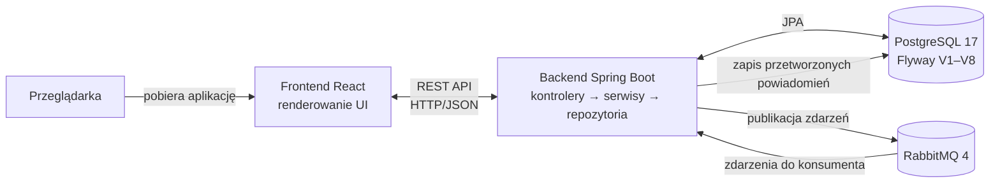
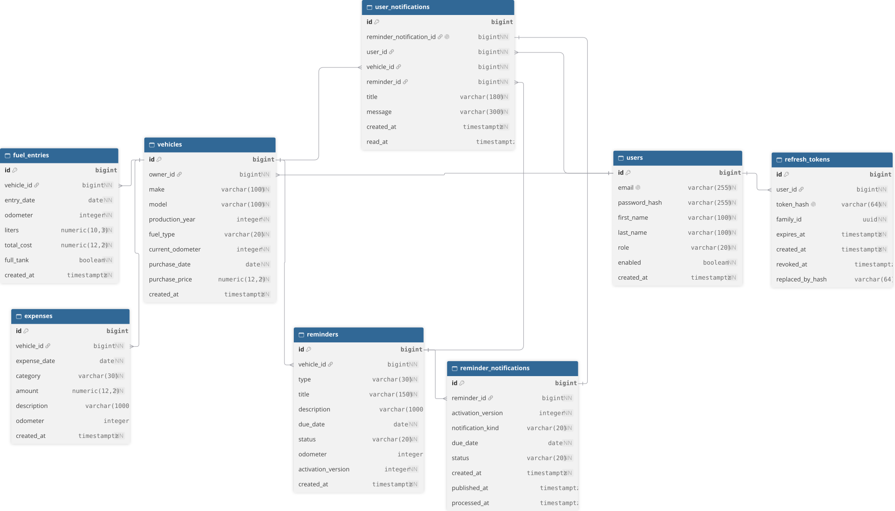

# RouteCost

Aplikacja webowa do zarządzania pojazdami, rejestrowania kosztów ich eksploatacji i pilnowania terminów obsługi. Frontend React komunikuje się z backendem Spring Boot przez REST API; PostgreSQL przechowuje dane, a RabbitMQ obsługuje asynchroniczne powiadomienia.

## Spis treści

- [O projekcie](#o-projekcie)
- [Funkcjonalności](#funkcjonalności)
- [Technologie](#technologie)
- [Architektura](#architektura)
- [Migracje Flyway](#migracje-flyway)
- [Struktura projektu](#struktura-projektu)
- [Model danych](#model-danych)
- [Diagram ERD](#diagram-erd)
- [Uwierzytelnianie i bezpieczeństwo](#uwierzytelnianie-i-bezpieczeństwo)
- [Reguły biznesowe](#reguły-biznesowe)
- [Asynchroniczne przypomnienia](#asynchroniczne-przypomnienia)
- [REST API i Swagger](#rest-api-i-swagger)
- [Wymagania środowiskowe](#wymagania-środowiskowe)
- [Lokalne uruchomienie bez Dockera](#lokalne-uruchomienie-bez-dockera)
- [Uruchomienie przez Docker Compose](#uruchomienie-przez-docker-compose)
- [Zmienne środowiskowe](#zmienne-środowiskowe)
- [Testy](#testy)
- [Znane ograniczenia](#znane-ograniczenia)
- [Dane demonstracyjne](#dane-demonstracyjne)

## O projekcie

RouteCost porządkuje informacje o eksploatacji pojazdu, które często są rozproszone między notatkami i rachunkami. Użytkownik prowadzi historię tankowań, wydatków i terminów obsługi, a następnie analizuje statystyki i koszty utrzymania.

## Funkcjonalności

- Rejestracja, logowanie, odtwarzanie sesji i wylogowanie.
- Obsługa kont USER i ADMIN oraz administracja kontami.
- Zarządzanie pojazdami i ich szczegółami.
- Historia tankowań, statystyki paliwa i spalanie liczone między pełnymi tankowaniami.
- Historia wydatków z filtrowaniem według kategorii i dat oraz statystykami.
- Przypomnienia serwisowe, zmiana statusu, filtrowanie i ponowna aktywacja.
- Dashboard, wykresy i raport kosztów dla pojazdu.
- Powiadomienia w aplikacji o nadchodzących i zaległych terminach.

## Technologie

| Obszar | Technologie |
|---|---|
| Backend | Java 21, Spring Boot 4.0.9, Spring MVC, Spring Security, Spring Data JPA/Hibernate, Bean Validation, Maven |
| API | REST, Springdoc OpenAPI 3.0.1 |
| Baza i migracje | PostgreSQL 17, Flyway |
| Komunikacja asynchroniczna | RabbitMQ 4, Spring AMQP |
| Frontend | React 19, TypeScript, Vite, React Router, Axios, TanStack Query, React Hook Form, Zod, Recharts, Lucide React |
| Testy | JUnit, Spring Boot Test, Vitest, Testing Library |
| Uruchamianie | Docker, Docker Compose |

## Architektura

Frontend jest aplikacją SPA i wywołuje endpointy REST backendu. Backend dzieli kod na moduły domenowe; typowy przepływ żądania przechodzi przez kontroler, serwis i repozytorium JPA do PostgreSQL. Flyway utrzymuje schemat bazy migracjami V1–V8. Scheduler i komponenty Spring AMQP realizują osobny przepływ zdarzeń przypomnień.



W Compose backend, frontend, PostgreSQL i RabbitMQ działają jako osobne usługi. Backend uruchamia się po uzyskaniu statusu healthy przez PostgreSQL i RabbitMQ. Baza korzysta z nazwanego wolumenu Compose.

## Migracje Flyway

Flyway zarządza schematem PostgreSQL. Pliki migracji SQL znajdują się w `backend/src/main/resources/db/migration/` i są wersjonowane kolejno od V1 do V8. Przy starcie backendu Spring Boot uruchamia Flyway automatycznie (`spring.flyway.enabled=true`), zanim aplikacja zacznie korzystać ze schematu; Hibernate sprawdza zgodność mapowania przez `spring.jpa.hibernate.ddl-auto=validate`.

Na nowej, pustej bazie Flyway tworzy schemat, wykonując dostępne migracje w kolejności. W typowym uruchomieniu nie trzeba ręcznie wywoływać migracji. Zastosowanych plików migracji nie należy edytować; kolejne zmiany schematu powinny być wprowadzane jako nowa migracja.

## Struktura projektu

```text
RouteCost/
├── backend/
│   └── src/
│       ├── main/java/pl/routecost/       # moduły domenowe backendu
│       ├── main/resources/db/migration/  # migracje Flyway V1–V8
│       └── test/java/pl/routecost/       # testy backendowe
├── frontend/
│   └── src/
│       ├── api/                          # klient HTTP i obsługa błędów
│       ├── features/                     # moduły widoków i funkcji
│       ├── routes/                       # routing i zabezpieczone trasy
│       └── components/                   # współdzielone komponenty
├── docs/erd/routecost.dbml               # źródło diagramu ERD
├── docker-compose.yml
└── README.md
```

Moduły backendu obejmują m.in. `admin`, `dashboard`, `expense`, `fuel`, `notification`, `reminder`, `user` i `vehicle`. Frontend grupuje widoki według tych samych obszarów funkcjonalnych.

## Model danych

Schemat końcowy definiowany przez migracje Flyway V1–V8 zawiera osiem tabel:

| Encja | Rola w modelu |
|---|---|
| `users` | Konto, rola i stan aktywności użytkownika. |
| `vehicles` | Pojazd należący do użytkownika. |
| `fuel_entries` | Tankowania i dane do obliczeń paliwa. |
| `expenses` | Wydatki związane z pojazdem, w PLN. |
| `reminders` | Terminy i statusy przypomnień dla pojazdu. |
| `reminder_notifications` | Trwałe zdarzenia/outbox powiadomień. |
| `refresh_tokens` | Skróty tokenów odświeżających i ich rodziny. |
| `user_notifications` | Powiadomienia użytkownika wraz ze stanem odczytu. |

Użytkownik może mieć wiele pojazdów i tokenów odświeżających. Pojazd grupuje tankowania, wydatki i przypomnienia. Przypomnienie może wygenerować zdarzenie outbox, a powiadomienie użytkownika wskazuje źródłowe zdarzenie.
## Diagram ERD

Diagram jest zgodny ze schematem po migracjach Flyway V1–V8. Jego źródło DBML znajduje się w [docs/erd/routecost.dbml](docs/erd/routecost.dbml).



## Uwierzytelnianie i bezpieczeństwo

- Hasła są przechowywane jako skróty BCrypt.
- Access token JWT jest ważny 15 minut i przesyłany w `Authorization: Bearer <token>`.
- Refresh token jest losowy; baza przechowuje jego SHA-256. Token przesyłany jest w cookie `HttpOnly`, którego odświeżenie rotuje token. Wykrycie ponownego użycia unieważnionego tokenu unieważnia jego aktywną rodzinę.
- Frontend przechowuje access token w pamięci i współdzieli odświeżenie sesji dla równoczesnych odpowiedzi 401.
- Publiczna rejestracja nadaje rolę USER. Endpointy `/api/admin/**` wymagają roli ADMIN.
- Dostęp do pojazdów i powiązanych danych jest ograniczony do właściciela; rola ADMIN nie omija tej kontroli.
- Rola i status konta są sprawdzane z bazą podczas uwierzytelniania żądań. Dezaktywacja konta blokuje dostęp i unieważnia aktywne tokeny odświeżające.
- Odświeżenie i wylogowanie wymagają cookie z `/api/auth` oraz nagłówka `X-RouteCost-Auth: 1`. CORS z credentials jest ograniczony do skonfigurowanego originu.

## Reguły biznesowe

- Tankowania nie mogą poprzedzać zakupu pojazdu ani naruszać chronologii przebiegu.
- Spalanie wyliczane jest dla odcinków między kolejnymi pełnymi tankowaniami; paliwo z tankowań pośrednich sumuje się do następnego pełnego tankowania.
- Koszt tankowania i kwota wydatku muszą być dodatnie. Wydatki są zapisywane w PLN.
- Przebieg podany przy tankowaniu lub wydatku podlega kontroli chronologii pojazdu.
- Data przypomnienia nie może poprzedzać daty zakupu pojazdu. Reaktywacja zakończonego lub anulowanego przypomnienia zwiększa jego wersję aktywacji.
- Operacje na pojazdach i zasobach zależnych sprawdzają właściciela.
- Administrator nie może zdezaktywować ani zdegradować własnego konta ani odebrać uprawnień ostatniemu aktywnemu administratorowi.

## Asynchroniczne przypomnienia

1. Scheduler skanuje aktywne przypomnienia domyślnie co 60 sekund, uwzględniając terminy z najbliższych 7 dni i terminy zaległe.
2. Serwis zapisuje zdarzenia ze statusem `PENDING` w tabeli `reminder_notifications`. Ograniczenie unikalności generacji zapobiega tworzeniu tego samego zdarzenia ponownie.
3. Publisher wysyła identyfikator zdarzenia do RabbitMQ i po publisher confirm oznacza rekord jako `PUBLISHED`.
4. Konsument sprawdza, czy przypomnienie jest nadal aktywne i czy wersja aktywacji się zgadza. W transakcji tworzy `user_notifications` i oznacza zdarzenie jako `PROCESSED`; nieaktualne zdarzenie otrzymuje status `DISCARDED`.
5. Ponowne dostarczenie zdarzenia jest obsługiwane idempotentnie; unikalność `user_notifications.reminder_notification_id` zabezpiecza przed duplikatem.
6. Listener wykonuje do trzech prób z przerwami 250 ms i 500 ms. Po ich wyczerpaniu wiadomość trafia do dead-letter queue (DLQ).

Kolejka główna: `routecost.reminder.notifications.v2`; DLQ: `routecost.reminder.notifications.v2.dlq`. Zachowana jest starsza kolejka `routecost.reminder.notifications` do obsługi pozostałych wiadomości. Zapis w bazie i publikacja do RabbitMQ nie są jedną transakcją rozproszoną; ponowne dostarczenia zabezpiecza idempotentne przetwarzanie. Użytkownik przegląda swoje powiadomienia w aplikacji, sprawdza licznik nieprzeczytanych i oznacza je jako przeczytane.

## REST API i Swagger

Po uruchomieniu backendu dokumentacja dostępna jest pod adresem [Swagger UI](http://localhost:8081/swagger-ui.html); OpenAPI JSON: [http://localhost:8081/v3/api-docs](http://localhost:8081/v3/api-docs). Dla chronionych endpointów należy przekazać access token w nagłówku Bearer. Rejestracja, logowanie, odświeżenie i wylogowanie są ścieżkami uwierzytelniania; pozostałe endpointy wymagają uwierzytelnienia, a `/api/admin/**` dodatkowo roli ADMIN.

Poniższa tabela jest skróconym zestawieniem najważniejszych tras, a nie pełnym opisem kontraktu. Pełne parametry, modele żądań i odpowiedzi oraz możliwość wywoływania endpointów z poziomu Swagger UI są dostępne w interaktywnej dokumentacji i OpenAPI JSON. Chronione operacje autoryzuje się access tokenem jako `Bearer`; endpointy administracyjne wymagają roli `ADMIN`. Rejestracja, logowanie, odświeżenie i wylogowanie są publicznymi trasami auth, przy czym odświeżenie i wylogowanie dodatkowo korzystają z refresh cookie oraz nagłówka `X-RouteCost-Auth: 1`.

| Obszar | Główne endpointy |
|---|---|
| Uwierzytelnianie | `POST /api/auth/register`, `/login`, `/refresh`, `/logout`; `GET /api/auth/me` |
| Pojazdy | `GET/POST /api/vehicles`; `GET/PUT/DELETE /api/vehicles/{vehicleId}` |
| Tankowania | `GET/POST /api/vehicles/{vehicleId}/fuel-entries`; `GET/PUT/DELETE /api/vehicles/{vehicleId}/fuel-entries/{entryId}`; `GET /api/vehicles/{vehicleId}/fuel-statistics` |
| Wydatki | `GET/POST /api/vehicles/{vehicleId}/expenses`; `GET/PUT/DELETE /api/vehicles/{vehicleId}/expenses/{expenseId}`; `GET /api/vehicles/{vehicleId}/expense-statistics` |
| Przypomnienia | `GET/POST /api/vehicles/{vehicleId}/reminders`; `GET/PUT/DELETE /api/vehicles/{vehicleId}/reminders/{reminderId}`; `PATCH .../{reminderId}/status`; `POST .../{reminderId}/reactivate` |
| Dashboard | `GET /api/dashboard/summary`; `GET /api/vehicles/{vehicleId}/cost-summary` |
| Administracja | `GET /api/admin/users`, `/api/admin/dashboard`; `PATCH /api/admin/users/{userId}/role`, `/status` |
| Powiadomienia | `GET /api/notifications`, `/unread-count`; `PATCH /api/notifications/{notificationId}/read`, `/read-all` |

Przykład sprawdzenia endpointu publicznej dokumentacji:

```bash
curl http://localhost:8081/v3/api-docs
```

Przykład wywołania wymagającego tokenu:

```bash
curl -H "Authorization: Bearer <access-token>" \
  "http://localhost:8081/api/vehicles"
```

### Przykładowa odpowiedź błędu

Niepoprawne pole w żądaniu obsłużonym przez Bean Validation zwraca HTTP `400 Bad Request`. `ApiExceptionHandler` ustawia tytuł i opis problemu oraz mapę `errors` z nazwami pól i komunikatami walidacji. Przykładowy kształt odpowiedzi:

```json
{
  "type": "about:blank",
  "title": "Validation failed",
  "status": 400,
  "detail": "One or more request fields are invalid.",
  "errors": {
    "email": "must be a well-formed email address"
  }
}
```

Wartości w `errors` zależą od pola i naruszonego ograniczenia. Dla błędów domenowych handler zwraca odpowiedni kod HTTP oraz opis w `detail`, np. `404` dla nieznanego zasobu, `409` dla konfliktu stanu lub `400` dla błędu chronologii.

## Wymagania środowiskowe

Do uruchomienia w kontenerach wymagane są Docker Engine/Desktop z Docker Compose oraz wolne porty `5432`, `5672`, `15672`, `8081` i `5174` (lub porty ustawione w `.env`). Aplikacja nie wymaga lokalnej instalacji Javy ani Node.js przy uruchomieniu Compose. Przy pracy bez kontenerów potrzebne są dodatkowo JDK 21, Node.js/npm, PostgreSQL 17 i RabbitMQ 4.

## Uruchomienie przez Docker Compose

W katalogu głównym repozytorium utwórz lokalny plik `.env` na podstawie przykładu, a następnie uzupełnij wymagane sekrety:

```powershell
Copy-Item .env.example .env
```

Wymagane do startu Compose są `DB_PASSWORD`, `RABBITMQ_PASSWORD` i `JWT_SECRET_BASE64`. Ustaw własne wartości zamiast przykładowych lokalnych haseł. Sekret JWT powinien być losowym kluczem zakodowanym Base64 o wystarczającej długości (co najmniej 256 bitów). Nie publikuj ani nie commituj `.env`.

Uruchom budowę obrazów i kontenery:

```powershell
docker compose up --build -d
docker compose ps
```

Adresy usług:

| Usługa | Adres |
|---|---|
| Frontend | http://localhost:5174 |
| Backend | http://localhost:8081 |
| Swagger UI | http://localhost:8081/swagger-ui.html |
| OpenAPI JSON | http://localhost:8081/v3/api-docs |
| RabbitMQ Management | http://localhost:15672 |
| PostgreSQL | `localhost:5432` |
| RabbitMQ AMQP | `localhost:5672` |

Porty frontend/backend można zmienić przez `FRONTEND_PORT` i `BACKEND_PORT`. Interfejs RabbitMQ Management używa danych ustawionych w `RABBITMQ_USERNAME` i `RABBITMQ_PASSWORD`.

Logi wszystkich usług lub wybranej usługi:

```powershell
docker compose logs -f
docker compose logs -f backend
```

Zatrzymanie kontenerów bez usuwania danych:

```powershell
docker compose down
```

`docker compose down -v` usuwa również wolumen `routecost_postgres_data` i zapisane w nim dane PostgreSQL. Używaj tego polecenia wyłącznie wtedy, gdy świadomie chcesz wyczyścić lokalną bazę.

## Zmienne środowiskowe

Pełna lista wartości opcjonalnych znajduje się w `.env.example`; Compose udostępnia następujące ustawienia:

| Zmienna | Znaczenie |
|---|---|
| `DB_USERNAME`, `DB_PASSWORD` | Konto PostgreSQL; hasło jest wymagane. |
| `RABBITMQ_USERNAME`, `RABBITMQ_PASSWORD` | Konto brokera; hasło jest wymagane. |
| `JWT_SECRET_BASE64` | Sekret podpisujący JWT zakodowany w Base64; wymagany. |
| `REFRESH_TOKEN_EXPIRATION` | Czas życia refresh tokenu, domyślnie `P7D`. |
| `REFRESH_COOKIE_NAME`, `REFRESH_COOKIE_SECURE`, `REFRESH_COOKIE_SAME_SITE` | Nazwa i atrybuty cookie odświeżającego. `SameSite=None` wymaga `Secure=true`. |
| `INITIAL_ADMIN_EMAIL`, `INITIAL_ADMIN_PASSWORD`, `INITIAL_ADMIN_FIRST_NAME`, `INITIAL_ADMIN_LAST_NAME` | Komplet danych początkowego administratora; opcjonalne wartości konfiguracyjne. |
| `BACKEND_PORT`, `FRONTEND_PORT` | Porty publikowane na hoście; domyślnie `8081` i `5174`. |
| `SPRING_PROFILES_ACTIVE` | Profil Springa; Compose domyślnie ustawia `dev`. |

Wewnątrz Compose backend łączy się z usługami pod nazwami `postgres` i `rabbitmq`. Przy uruchomieniu backendu poza Compose można skonfigurować m.in. `DATABASE_URL`, `RABBITMQ_HOST` i `RABBITMQ_PORT`. Dla lokalnego HTTP ustawienie cookie domyślnie ma `Secure=false`; konfiguracja wdrożenia HTTPS powinna używać `Secure=true`.

## Testy

Testy istnieją w repozytorium, ale w ramach przygotowania tej dokumentacji ich nie uruchamiano; poniższe polecenia opisują sposób uruchomienia, nie wynik.

Backendowe testy JUnit i Spring Boot Test znajdują się w `backend/src/test/java`. Obejmują m.in. obliczenia spalania, statusy przypomnień, uwierzytelnianie, reguły domenowe i integracyjne testy API. Uruchomienie z katalogu głównego w PowerShell:

```powershell
Push-Location backend
.\mvnw.cmd test
Pop-Location
```

Testy integracyjne korzystają z usług środowiskowych PostgreSQL i RabbitMQ skonfigurowanych dla backendu. Projekt nie konfiguruje Testcontainers, dlatego przygotuj odizolowane instancje testowe; nie kieruj testów do bazy ani brokera ze współdzielonymi danymi aplikacji.

Testy frontendu używają Vitest, jsdom i Testing Library. Pliki testowe `*.test.*` są umieszczone przy kodzie w `frontend/src`. W katalogu `frontend`:

```powershell
npm ci
npm test
npm run lint
npm run build
```

Testy obejmują m.in. routing, formularze i walidację, klient API, widoki funkcjonalne oraz narzędzia pomocnicze.

## Znane ograniczenia

- Testy integracyjne backendu nie korzystają z Testcontainers. Wymagają dostępnego PostgreSQL i RabbitMQ skonfigurowanych dla procesu testowego; do ich uruchamiania należy przygotować odizolowane usługi testowe.
- PostgreSQL i RabbitMQ nie uczestniczą w jednej transakcji rozproszonej. Rekord outboxa, publisher confirms, ponawianie publikacji i idempotentny konsument ograniczają skutki awarii oraz duplikatów, ale nie zapewniają atomowego zatwierdzenia zmian w obu usługach.
- Powiadomienia o przypomnieniach są zapisywane i udostępniane w aplikacji przez REST API. W repozytorium nie ma integracji wysyłającej e-mail ani powiadomienia push.
- Repozytorium zawiera lokalny Docker Compose, a nie potwierdzone wdrożenie produkcyjne. Nie ma tu wyników wdrożenia ani jego monitoringu; uruchomienie Compose nie stanowi weryfikacji środowiska produkcyjnego.

## Dane demonstracyjne

Lokalne środowisko developerskie tworzy trzy przykładowe konta użytkowników. Każde ma rolę `USER`, jest aktywne i używa hasła zahashowanego istniejącym mechanizmem BCrypt.

| Konto | E-mail | Hasło | Zawartość i zastosowanie |
|---|---|---|---|
| EMPTY | `demo.empty@routecost.local` | `RouteCostDemo1!` | Jedna Toyota Corolla, bez tankowań, wydatków i przypomnień. Do sprawdzania pustych stanów i pierwszego dodawania danych. |
| STANDARD | `demo.standard@routecost.local` | `RouteCostDemo2!` | Jedna Skoda Octavia, 6 tankowań, 5 wydatków z różnych kategorii i 3 przypomnienia: zaległe aktywne, nadchodzące aktywne oraz zakończone. Do typowego scenariusza użytkownika. |
| FULL | `demo.full@routecost.local` | `RouteCostDemo3!` | Toyota Corolla (11 tankowań i 11 wydatków) oraz Kia Ceed (7 tankowań i 7 wydatków), łącznie 18 tankowań i 18 wydatków z różnych kategorii oraz 8 przypomnień o statusach aktywnych, zakończonych i anulowanych. Historia przekracza 10 wpisów dla pierwszego pojazdu, więc pokazuje paginację; daty obejmują wiele miesięcy. Do testowania dashboardu, statystyk, kosztów, spalania, filtrów, paginacji i wykresów. |

Konta są przeznaczone wyłącznie do lokalnego środowiska demonstracyjnego. Seed jest idempotentny: przy każdym starcie sprawdza, czy konto już istnieje; istniejących kont ani ich danych nie zmienia i nie uzupełnia. Hasła nie są wypisywane w logach. Seed działa wyłącznie przy aktywnym profilu Spring `dev` i jest wyłączony, gdy aktywny jest profil `prod` — również wtedy, gdy omyłkowo aktywowano oba profile. Nie powinien być włączany w publicznym wdrożeniu.

Standardowe uruchomienie lokalnego środowiska Docker Compose aktywuje profil `dev` dla backendu:

```bash
docker compose up --build -d
```

Aby uruchomić Compose bez seeda (na przykład przy lokalnym sprawdzaniu konfiguracji produkcyjnej), ustaw profil inny niż `dev`:

```powershell
$env:SPRING_PROFILES_ACTIVE = "prod"
docker compose up --build -d
```

Przed kolejnym uruchomieniem developerskim przywróć profil `dev` albo usuń zmienną `SPRING_PROFILES_ACTIVE` z bieżącej sesji PowerShell. Samo zatrzymanie kontenerów nie usuwa bazy ani kont demonstracyjnych.
